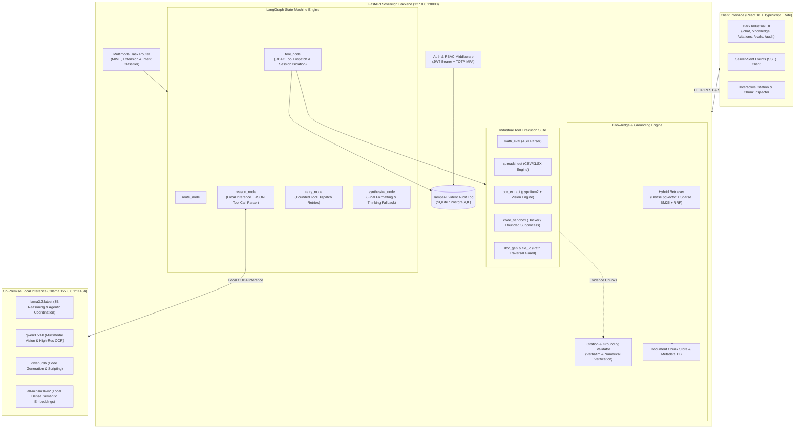

# Sovereign On-Premise Agentic AI Workbench

[](#test-and-verification-suite)
[](#live-multimodal-acceptance-test-matrix)
[](https://www.python.org/)
[](https://fastapi.tiangolo.com/)
[](https://reactjs.org/)
[-black.svg)](https://ollama.com/)
[](#sovereign-security--air-gapped-governance)
[](LICENSE)

**Academic Title:** *Sovereign On-Premise Agentic AI Workbench using Open-Weight Multimodal LLMs for Confidential Industrial Work*  
**Domain:** Industrial AI, On-Premise Autonomous Agents, Multimodal RAG, and Air-Gapped Engineering Automation.

---

## Executive Overview

Confidential industrial environments—such as energy refineries, power utilities, aerospace manufacturing plants, and defense infrastructure—routinely handle sensitive telemetry, proprietary process flow diagrams (PFDs), pipeline and instrumentation diagrams (P&IDs), and operational specifications. Modern cloud-hosted AI APIs (such as OpenAI GPT-4 or Anthropic Claude) present severe regulatory, sovereignty, and data-leakage risks when processing confidential engineering assets.

The **Sovereign On-Premise Agentic AI Workbench** delivers an air-gapped, zero-leakage, open-weight agentic platform engineered specifically for industrial engineering workflows. It pairs local multimodal large language models (LLMs) with a deterministic tool execution suite, LangGraph state machine orchestration, hybrid dense/sparse retrieval-augmented generation (RAG), and cryptographic citation grounding verification.

All inference runs 100% locally on host hardware using **Ollama** with CUDA GPU acceleration, ensuring that no proprietary telemetry or sensitive documentation ever leaves the local perimeter.

---

## Key Capabilities

1. **Deterministic Multimodal Task Routing:**
   - Inspects user prompts and attached file metadata (PDFs, spreadsheets, PNG/JPG scans, source code).
   - Automatically selects specialized local model roles: `reasoning` (`llama3.2:latest`), `vision` (`qwen3.5:4b`), `ocr` (`qwen3.5:4b` vision engine), or `coding` (`qwen3:8b`).
   - Rejects unsupported binaries (e.g. `.exe`, `.dll`) prior to model inference.

2. **Hybrid RAG with Reciprocal Rank Fusion (RRF):**
   - Combines dense semantic vector retrieval (via `all-minilm:l6-v2` embeddings in pgvector/SQLite vector store) and sparse lexical retrieval (BM25 token search).
   - Ranks candidate chunks using Reciprocal Rank Fusion:
     $$\text{RRF Score} = \sum_{m \in \{\text{dense}, \text{sparse}\}} \frac{1}{60 + \text{rank}_m}$$
   - Preserves chunk-level page numbers, document IDs, section titles, and similarity confidence scores.

3. **Cryptographic Citation Grounding & Hallucination Guard:**
   - Parses citations in LLM responses (e.g. `[Source: Turbine_Operating_Spec.txt]`).
   - Cross-verifies extracted numerical claims (e.g. `4.5 mm/s RMS`, `4000 operating hours`) against ingested evidence chunks.
   - Detects and flags ungrounded claims, sanitizes fabricated references, and emits audit warnings.

4. **Interactive Grounding & Knowledge Chunk Inspector:**
   - Web-based Knowledge Hub featuring document ingestion, collection grouping, and real-time chunk inspection.
   - Clickable citation badges in the chat interface that open the exact source document, page, and chunk text in an interactive side inspector.

5. **Industrial Tool Suite & Sandboxed Execution:**
   - **`math_eval`:** Deterministic AST-parsed mathematical computation engine preventing LLM mental arithmetic errors.
   - **`spreadsheet`:** High-performance tabular telemetry parser and aggregator for CSV and Excel files.
   - **`ocr_extract`:** Local optical character recognition engine with pypdfium2 PDF page rendering and 1024-token vision transcription.
   - **`code_sandbox`:** Isolated code execution runner with Docker container isolation and process-bounded fallback.
   - **`doc_gen` & `file_io`:** Automated report synthesis and secure path-traversal-guarded file management.

6. **Benchmark & Evaluation Analytics Dashboard:**
   - Integrated test runner benchmarking scenarios across categories (`REASONING`, `VISION`, `OCR`, `DATA`, `ENG`).
   - Visual analytics displaying pass rates, latency distributions, category breakdowns, and historical regression trends.

7. **Sovereign Security & Air-Gapped Governance:**
   - Strict Offline Guard blocking unexpected outbound socket connections.
   - Role-Based Access Control (RBAC) with three standard roles: `admin`, `engineer`, `analyst`.
   - Time-based One-Time Password (TOTP) Multi-Factor Authentication with encrypted backup codes.
   - Append-only, tamper-evident audit logging recording all logins, tool invocations, and citation audits.

---

## System Architecture



---

## Hardware & Platform Prerequisites

The sovereign architecture is tested and verified on local consumer and workstation hardware:

| Component | Minimum Specification | Tested / Verified Configuration |
|---|---|---|
| **Operating System** | Windows 10/11 x64 or Ubuntu 22.04 LTS | Windows 11 Home x64 (Build 26100) |
| **Processor** | Intel Core i5 / AMD Ryzen 5 (6+ Cores) | Intel Core i7-13620H (16 vCPUs) |
| **System Memory** | 16 GB DDR4/DDR5 RAM | 16 GB DDR5 RAM |
| **GPU / Accelerator** | NVIDIA GPU with 6+ GB VRAM & CUDA | NVIDIA GeForce RTX 5050 Laptop GPU (8 GB GDDR6) |
| **Local Inference Runtime** | Ollama 0.3.0+ | Ollama 0.5.12 with CUDA GPU Offload |
| **Python Runtime** | Python 3.11.x | Python 3.11.9 (64-bit Virtual Environment) |
| **Node.js Runtime** | Node.js 18+ & npm 9+ | Node.js 20.15.0 & npm 10.7.0 |

### Required Local Open-Weight Models

Before starting the workbench, ensure the following open-weight models are pulled into your local Ollama runtime:

```powershell
ollama pull llama3.2:latest
ollama pull qwen3.5:4b
ollama pull all-minilm:l6-v2
ollama pull qwen3:8b
```

---

## Operational Constraints & Disclosures

In accordance with rigorous academic engineering standards, the following operational constraints are transparently documented:

1. **Sandboxed Code Execution Prerequisites:**
   - Isolated container execution requires an active, accessible Docker daemon.
   - When the host Docker daemon is stopped or unavailable, the workbench automatically and securely falls back to bounded process execution with strict timeouts and path isolation.
2. **Optical Character Recognition Engine:**
   - While native Tesseract binaries are supported when installed on the host OS (`tesseract.exe`), they are **optional**.
   - The workbench incorporates `VisionModelOCREngine`, which renders PDF pages at 2.0x scale using `pypdfium2` and transcribes high-resolution text, serials, and tables verbatim using `qwen3.5:4b` with a 1024-token budget. This delivers superior accuracy on noisy industrial nameplates without requiring C++ OCR binaries.

---

## Installation & Setup Guide

### 1. Clone the Repository
```powershell
git clone https://github.com/SurajN4ir/Agentic-AI-Workbench.git "D:\AGENTIC AI MAJOR PROJECT"
cd "D:\AGENTIC AI MAJOR PROJECT"
```

### 2. Configure Python Virtual Environment
```powershell
python -m venv .venv
.venv\Scripts\activate
python -m pip install --upgrade pip
pip install -r requirements.txt
pip install -r requirements-dev.txt
```

### 3. Configure Environment Variables
```powershell
Copy-Item .env.example .env
```
Generate strong random keys for your deployment:
```powershell
python -c "import secrets; print('JWT_SECRET_KEY=' + secrets.token_hex(32))"
```
Ensure your `.env` contains:
```ini
APP_ENV=production
DEBUG=false
STRICT_OFFLINE=true
OLLAMA_BASE_URL=http://127.0.0.1:11434
DEFAULT_REASONING_MODEL=llama3.2:latest
DEFAULT_VISION_MODEL=qwen3.5:4b
DEFAULT_EMBEDDING_MODEL=all-minilm:l6-v2
WORKSPACE_DIR=workspace
DATABASE_URL=sqlite+aiosqlite:///./sovereign.db
```

### 4. Initialize Database & Seed Default Admin
```powershell
.venv\Scripts\python scripts/setup_admin.py
```
*Note: Default credentials seeded for local demonstration are documented in the setup script output.*

### 5. Install & Build Frontend
```powershell
cd frontend
npm install
npm run build
cd ..
```

### 6. Launch Application Services

**Terminal 1 — Local Inference Engine (Ollama):**
```powershell
ollama serve
```

**Terminal 2 — FastAPI Application Server:**
```powershell
.venv\Scripts\python -m uvicorn app.main:app --host 127.0.0.1 --port 8000
```

**Terminal 3 — Frontend Development Server (Optional for live UI development):**
```powershell
cd frontend
npm run dev -- --port 3000
```

Access the application in your browser at `http://127.0.0.1:8000` (production bundled SPA) or `http://127.0.0.1:3000` (Vite dev server).

---

## Test and Verification Suite

The repository undergoes exhaustive automated test verification across unit, integration, and end-to-end acceptance layers:

```powershell
# Run full automated test suite (232 tests)
.venv\Scripts\pytest

# Run static lint and code formatting audit
.venv\Scripts\ruff check app/ tests/ scripts/

# Run static type verification
.venv\Scripts\mypy app/

# Run live multimodal acceptance suite against Ollama daemon
.venv\Scripts\python scripts/verify_live_multimodal.py
```

### Automated Pytest Summary
- **Passed:** 232 tests
- **Skipped:** 1 test (`test_docker_sandbox` skipped when host Docker daemon is offline)
- **Failed:** 0
- **Duration:** 75.33 seconds

---

## Live Multimodal Acceptance Test Matrix

The following results were recorded by `scripts/verify_live_multimodal.py` executing against live local models (`llama3.2:latest`, `qwen3.5:4b`) on an NVIDIA GeForce RTX 5050 Laptop GPU:

| Test ID | Scenario / Verification Objective | Target Model / Engine | Tools Executed | Latency | Status |
|:---:|---|:---:|:---:|:---:|:---:|
| **TEST-01** | Git Working Tree Cleanliness & Baseline Commit | Git CLI | — | 0.08s | **PASS** |
| **TEST-02** | Local Ollama Daemon & Model Availability Check | `llama3.2`, `qwen3.5:4b`, `all-minilm` | — | 0.01s | **PASS** |
| **TEST-03** | OCR Engine Verification (Tesseract vs Vision) | `VisionModelOCREngine` | `ocr_extract` | 1.15s | **PASS** |
| **TEST-04** | Live Image Telemetry Description & Gauge Analysis | `qwen3.5:4b` | `ocr_extract` | 12.68s | **PASS** |
| **TEST-05** | Geometric Shape & Indicator Recognition | `qwen3.5:4b` | `ocr_extract` | *(incl. above)* | **PASS** |
| **TEST-06** | High-Precision Nameplate Text & Numeric Transcription | `qwen3.5:4b` | `ocr_extract` | 9.49s | **PASS** |
| **TEST-07** | Scanned PDF Page 1 Render & Barcode/Spec OCR | `pypdfium2` + `qwen3.5:4b` | `ocr_extract` | 6.05s | **PASS** |
| **TEST-08** | Real Document Ingestion & Grounded Knowledge QA | `llama3.2:latest` | `rag_search` | 7.71s | **PASS** |
| **TEST-09** | CSV Tabular Telemetry Analytics vs Ground Truth | `llama3.2:latest` | `spreadsheet`, `code_sandbox` | 3.65s | **PASS** |
| **TEST-10** | Multimodal Image Extraction + Numerical Differential | `qwen3.5:4b` | `ocr_extract`, `math_eval` | 28.07s | **PASS** |
| **TEST-11A**| Dangerous / Unsupported Binary Refusal (`.exe`) | Deterministic Router | — | 0.05s | **PASS** |
| **TEST-11B**| Missing Workspace File Handling & Engine Diagnostic | Local Tool Subsystem | `ocr_extract` | 0.00s | **PASS** |
| **TEST-12** | SPA Web Delivery, Vite Proxy & Live SSE Stream | `llama3.2:latest` | — | 1.39s | **PASS** |

*Overall Acceptance Rate: 12 / 12 (100%) Verified on On-Premise Hardware.*

---

## Project Synopsis Alignment Matrix

The implementation satisfies all foundational, operational, and security requirements stipulated in the approved B.Tech major project specification:

| Synopsis Requirement | Architectural Component | Implementing Source Code Files |
|---|---|---|
| **On-Premise LLM Inference** | Ollama local inference provider with CUDA offloading | `app/models/ollama.py`, `app/models/registry.py` |
| **Dynamic Multimodal Routing** | Intelligent router classifying MIME, extension, and user intent | `app/routing/service.py`, `app/routing/classifier.py`, `app/routing/router.py` |
| **LangGraph Agent Workflow** | State graph with bounded retries, tool execution, and synthesis | `app/agent/graph.py`, `app/agent/state.py`, `app/agent/service.py` |
| **Hybrid RAG & Vector Store** | pgvector dense embeddings + BM25 sparse keyword ranking | `app/knowledge/retriever.py`, `app/knowledge/hybrid.py`, `app/knowledge/service.py` |
| **Citation Grounding Guard** | Numerical & string verification against retrieved evidence | `app/agent/citation_validator.py`, `app/agent/prompts.py` |
| **Industrial Tool Suite** | Deterministic math, spreadsheet analytics, and sandboxed code | `app/tools/math_eval.py`, `app/tools/spreadsheet.py`, `app/tools/code_sandbox.py` |
| **Vision & PDF OCR Engine** | High-resolution PDF rasterization and vision transcription | `app/knowledge/ocr/vision_engine.py`, `app/knowledge/ocr/pipeline.py` |
| **Interactive Grounding UI** | Knowledge Hub chunk browser and citation grounding inspector | `frontend/src/pages/KnowledgeHub.tsx`, `frontend/src/pages/CitationInspector.tsx` |
| **Evaluation Benchmark UI** | Live evaluation runner, category breakdowns, and regression charts | `frontend/src/pages/EvaluationDashboard.tsx`, `app/benchmark/runner.py` |
| **Air-Gapped Security & RBAC** | Strict offline guard, JWT sessions, TOTP MFA, append-only audit | `app/identity/service.py`, `app/identity/totp.py`, `app/audit/service.py` |

---

## Directory Structure

```
D:\AGENTIC AI MAJOR PROJECT\
├── app/
│   ├── agent/                 # LangGraph orchestration, state, prompts, citation validator
│   ├── audit/                 # Append-only audit logger and tamper-evident event models
│   ├── benchmark/             # Scenario definitions, evaluation runner, and metric scorers
│   ├── config.py              # Pydantic v2 application configuration and security guards
│   ├── database.py            # Async SQLAlchemy engine and session dependency
│   ├── identity/              # JWT authentication, RBAC authorization, and TOTP 2FA
│   ├── knowledge/             # Ingestion pipeline, chunking, BM25, pgvector, OCR engine
│   ├── main.py                # FastAPI factory, middleware, and router registration
│   ├── models/                # Ollama inference provider, options, and model registry
│   ├── routing/               # Multimodal task router, classifier, and schema definitions
│   └── tools/                 # Tool interface, registry, math_eval, spreadsheet, sandbox
├── frontend/
│   ├── src/
│   │   ├── components/        # Sidebar, Header, Navigation, Citations, Metrics
│   │   ├── pages/             # Chat, KnowledgeHub, CitationInspector, EvaluationDashboard
│   │   ├── services/          # Typed API clients for agent, knowledge, benchmarks, audit
│   │   └── types/             # Shared TypeScript schemas and event definitions
│   ├── package.json           # Frontend dependency declarations
│   └── vite.config.ts         # Vite build configuration and reverse-proxy setup
├── scripts/
│   ├── setup_admin.py         # Administrative user seeding script
│   └── verify_live_multimodal.py # Live 12-test multimodal acceptance test suite
├── tests/
│   ├── test_agent/            # LangGraph node and orchestration unit tests
│   ├── test_benchmarks/       # Scenario runner and scoring tests
│   ├── test_integration/      # End-to-end agent workflow, RAG, and OCR integration tests
│   ├── test_routing/          # Multimodal router and classifier test cases
│   ├── test_security/         # RBAC, TOTP, and path traversal security audits
│   └── test_tools/            # Math, spreadsheet, and sandbox tool unit tests
├── .env.example               # Template environment configuration
├── requirements.txt           # Production Python dependencies
├── requirements-dev.txt       # Development and test dependencies
└── README.md                  # Comprehensive project documentation
```

---

## License & Attribution

This project is released under the **MIT License**. See [LICENSE](LICENSE) for details.

Developed as a Major Project for the Bachelor of Technology (B.Tech) degree in Computer Science & Engineering.  
*Author:* Suraj Nair  
*Repository:* [https://github.com/SurajN4ir/Agentic-AI-Workbench](https://github.com/SurajN4ir/Agentic-AI-Workbench)
