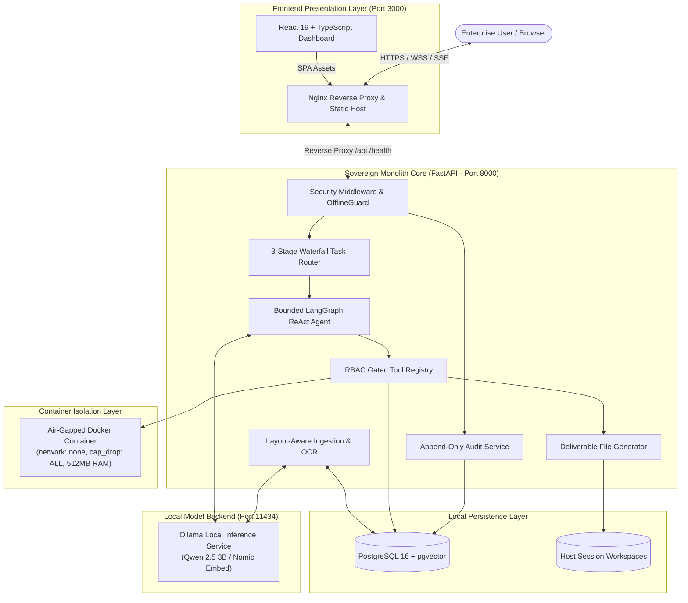
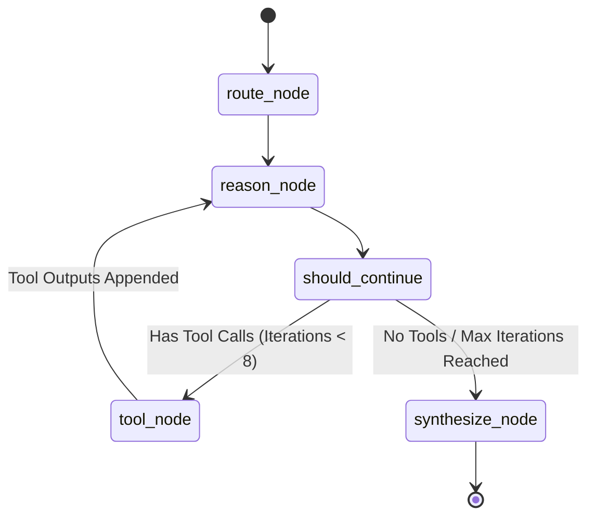

# Sovereign Workbench Architecture Specification

## 1. Executive Summary

The **Sovereign On-Premise Agentic AI Workbench** is an air-gapped, privacy-first enterprise platform designed for confidential industrial, defense, and high-security enterprise workflows. It guarantees that zero customer proprietary data, engineering designs, or telemetry leaves the physical host environment.

### Core Architectural Axioms
1. **Zero External Cloud Egress:** All model weights, embeddings, vector databases, OCR engines, and execution sandboxes execute strictly within the local perimeter (127.0.0.1 / internal container network).
2. **Fail-Closed Security Model:** Untrusted code execution operates exclusively in isolated, capability-dropped, unnetworked containers. If isolation is unavailable, execution fails cleanly rather than falling back to host execution.
3. **Deterministic Memory Safety & AST Math:** Symbolic mathematics and numerical computations bypass Python `eval()` / `exec()` entirely, utilizing an AST-based SymPy solver.
4. **Layout-Aware Knowledge Processing:** Document ingestion preserves complex table boundaries, headings, and sheet structures across PDF, DOCX, XLSX, and TXT files, linking vector embeddings to explicit page/row citations.
5. **Bounded Agent Execution:** The autonomous ReAct loop is bounded by hard iteration ceilings (default 8, maximum 15) to prevent infinite loops, hallucinated recursions, or resource exhaustion.

---

## 2. System Architecture

---

## 3. Subsystem Breakdown

### 3.1. Identity, Authentication & RBAC
- **Password Hashing:** Bcrypt with 12 computational rounds, maintaining PBKDF2 backwards compatibility. Constant-time dummy verification is executed on unknown usernames to prevent timing attacks.
- **Two-Factor Authentication (2FA):** Time-based One-Time Passwords (RFC 6238 TOTP) using base32 secrets and QR-code pairing.
- **Session Tokens:** Stateless cryptographically signed JWTs (HS256) strictly transmitted via `Authorization: Bearer <token>` HTTP headers. Tokens in query strings are rejected to prevent log leakage.
- **Role-Based Access Control (RBAC):**
  - `admin`: User administration, global audit inspection, system configuration.
  - `developer`: Code execution sandbox, symbolic math, document retrieval, file generation.
  - `analyst`: Symbolic math, document retrieval, deliverable generation.
  - `operator`: Document retrieval, deliverable generation.
  - `viewer`: Read-only queries.

### 3.2. 3-Stage Waterfall Task Router
Incoming prompts are routed through a 4-tier decision cascade in <15ms:
1. **Stage 0 (Manual Override):** Explicit user persona or model selection.
2. **Stage 0.5 (Multimodal Classifier):** Base64/image input detection -> routes to `vision` (`qwen2.5-vl:3b`).
3. **Stage 1 (Extension Analysis):** File extension inspection (`.py`, `.ts`, `.sh` -> `coding`; `.xlsx`, `.csv` -> `coding`).
4. **Stage 2 (Keyword Boundary Inspection):** 40+ regex word boundaries (`def `, `import `, `integral`, `solve`, `eigenvalue`, `plot`) -> `coding` or `math`.
5. **Stage 3 (In-Memory Logistic Classifier):** Scikit-learn TF-IDF + Logistic Regression fitted at startup (~15ms) on synthetic domain vectors. **Zero `.pkl` files stored on disk** to prevent deserialization vulnerabilities.

### 3.3. Local Inference Engine
- Uses `OllamaProvider` connecting via loopback socket to local Ollama daemon.
- Performs runtime extraction and separation of `<think>` reasoning traces from the final response stream.
- Computes dense vector embeddings locally using `nomic-embed-text` (768 dimensions).

### 3.4. Layout-Aware Knowledge Ingestion & RAG
- **Parsers:**
  - `pypdfium2`: High-speed PDF rendering and text layer extraction.
  - `python-docx`: Heading hierarchy, body paragraphs, and structured table grid parsing.
  - `openpyxl`: Multi-sheet cell reading, headers, and formula preservation.
  - `TesseractOCREngine`: Pluggable fallback OCR for scanned PDFs and embedded document images.
- **Chunking Engine:** Layout-aware recursive chunker preserving tables as atomic Markdown tables with inherited section breadcrumbs (`Document > Section > Subsection`).
- **Vector Search:** Async PostgreSQL `pgvector` index using cosine similarity distance (`<=>`). Every result returns explicit provenance citations: `[Source: filename | Page X]`.

### 3.5. Bounded LangGraph Agent Loop

- Built on LangGraph `StateGraph(WorkbenchState)`.
- Enforces an execution boundary (`max_iterations = 8`, hard max 15).
- If the model loops or attempts redundant tool dispatches beyond the bound, the graph transitions directly to `synthesize_node` with status `max_iterations_reached`.

### 3.6. Air-Gapped Code Sandbox & Math Evaluator
- **Docker Sandbox:** Runs inside `python:3.11-slim` with:
  - `network_mode = "none"` (hardware/kernel network stack detached)
  - `cap_drop = ["ALL"]` (all root capabilities revoked)
  - `pids_limit = 50` (fork-bomb mitigation)
  - `mem_limit = "512m"` (OOM guardrail)
  - Non-root user execution (`uid:gid = 1000:1000`)
  - Fail-closed: Never falls back to host execution if Docker is offline.
- **SymPy Math Evaluator:** Evaluates equations, limits, derivatives, and matrix operations using SymPy abstract syntax trees without invoking Python `eval()`.

### 3.7. Deliverable File Generator (`doc_gen`)
Autonomous artifact generation creating executive-ready files:
- **Word (.docx):** Corporate heading styles, clean tables with alternate row tinting, bold headers, and page margins.
- **Excel (.xlsx):** Auto-adjusted column widths, formatted numeric headers, grid styling.
- **Markdown (.md):** Clean structural summaries.
All generated files are strictly validated against session workspace boundaries using `validate_workspace_path()`.

---

## 4. Hardware Optimization (AMD Ryzen AI + Radeon 860M)

The platform is explicitly tuned for developer workstations and edge industrial nodes with **24 GB RAM** and integrated **AMD Radeon 860M (RDNA 3.5)**:
- **Default Models:** 3B 4-bit quantized parameters (`qwen2.5:3b`, `qwen2.5-coder:3b`, `qwen2.5-vl:3b`).
- **VRAM Footprint:** ~2.1 GB to 2.4 GB per model instance.
- **Host RAM Budget:**
  - OS + Desktop: ~4.0 GB
  - PostgreSQL + pgvector: ~1.0 GB
  - Ollama runtime + model: ~5.0 GB
  - Sovereign Workbench Monolith: ~1.5 GB
  - Sandbox container (when active): ~0.5 GB
  - Available system headroom: >11.0 GB
- **Inference Mode:** Supports standard CPU inference out-of-the-box; supports AMD ROCm/HIP acceleration via container device mapping (`/dev/kfd`, `/dev/dri`).
